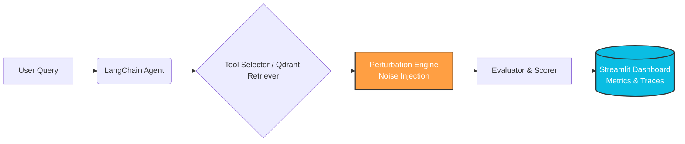

# 🚀 NARADA
### Noise-Aware Retrieval and Decision Assessment for AI Agents

---

## 📖 Overview

**The Problem:** AI agents frequently fail in real-world environments. They choose wrong tools, use incorrect arguments, or hallucinate answers when provided documents or tools are irrelevant, missing, conflicting, or corrupted. 

**The Solution:** NARADA is a comprehensive evaluation framework that stress-tests AI agents under controlled noise. Instead of assuming clean inputs, NARADA intentionally injects environmental noise to measure agent accuracy, abstention rates, and specific failure modes, ensuring robust and reliable AI deployment.

---

## ✨ Key Features & Outcomes

- 🧠 **Intelligent RAG Agent:** LangChain-powered agent with Qdrant vector retrieval and ~30 mock enterprise tools.
- 🌪️ **Perturbation Engine:** Systematically injects 6 distinct noise types (irrelevant, missing, conflicting, corrupted, etc.) into the agent's context.
- 📊 **150-Task Benchmark:** Rigorous dataset designed to stress-test reasoning and tool selection under varying noise severities.
- ⚖️ **Model Parity Testing:** Direct comparison of local models (via Ollama) against commercial API models.
- 🛡️ **Advanced Safety Metrics:** Evaluates accuracy, abstention behavior, and classifies specific failure modes (e.g., wrong tool, hallucination).
- 🖥️ **Command Center Dashboard:** Interactive Streamlit UI for real-time execution tracing, benchmark runs, and visual analytics.

---

## 🏗️ System Architecture

---

## 🛠️ Technology Stack

- **Core AI & Orchestration:** Python 3.10+, LangChain, LangChain Community
- **Vector Database:** Qdrant
- **Embeddings:** sentence-transformers
- **Local LLM Inference:** Ollama
- **Frontend / UI:** Streamlit
- **Data & Analytics:** Pandas, Plotly
- **Hardware Requirements:** 4-core CPU, 16 GB RAM, 20 GB Storage (GPU optional)

---

## 👥 Development Team

| USN | Name | Section | Role & Focus Area |
| :--- | :--- | :---: | :--- |
| **1NH24CS235** | A G Venkateswaran | D | **AI Core & Evaluation Lead:** RAG Pipeline, Perturbation Engine, Evaluation Metrics. |
| **1NH24CS212** | Sudharshan V C | D | **Data, UI & Infrastructure Lead:** Mock Tools, Benchmark Dataset, Streamlit Dashboard. |

---

© 2026 NARADA Project Team. All rights reserved.
