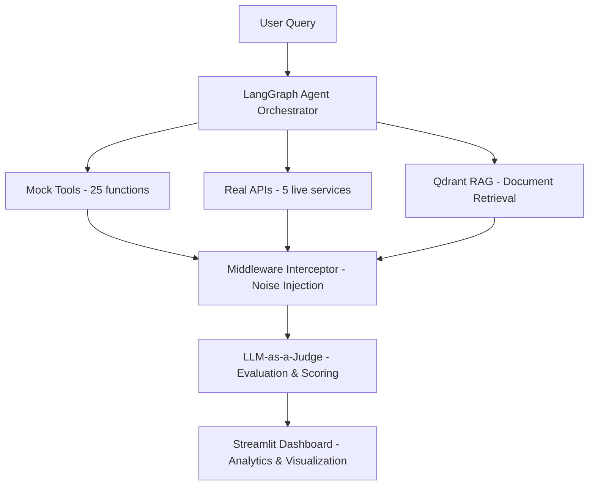

# 🛡️ NARADA: Noise-Aware Retrieval and Decision Assessment for AI Agents


[](https://www.python.org/)
[](https://python.langchain.com/docs/langgraph)
[](https://ollama.com/)
[](https://streamlit.io/)

**NARADA** is an enterprise-grade autonomous AI agent evaluation framework that stress-tests Large Language Models (LLMs) under adversarial noise conditions. It benchmarks real-world agent performance across 150+ tasks using live APIs, mock tools, and controlled perturbations.

---

## 🎯 Problem Statement

As enterprises deploy autonomous AI agents to interact with real-world APIs (Search, Weather, Code Execution), these agents become highly vulnerable to:
* **Adversarial noise** in tool outputs
* **Conflicting context** in retrieved documents  
* **Corrupted API responses**
* **Hallucinated tool arguments**

Current evaluation methods rely on synthetic mock environments that fail to capture real-world complexity. **NARADA solves this** by providing a production-grade red-teaming framework.

---

## ✨ Key Features

### 🔬 **Advanced Evaluation**
* **150-Task Benchmark Dataset** covering real-world scenarios
* **LLM-as-a-Judge** semantic evaluation system
* **Automated Failure Classification** (Wrong Tool, Argument Hallucination, Context Failure)
* **Abstention Rate Tracking** (measuring AI safety)

### 🔌 **Real-World Testing**
* **25 Mock Tools** for controlled baseline testing
* **5 Live APIs**: DuckDuckGo Search, Wikipedia, Open-Meteo Weather, Arxiv, Python REPL
* **Middleware Interceptor** to inject adversarial noise into real API responses
* **Qdrant Vector Database** with hybrid semantic search

### 🤖 **Multi-Model Comparison**
* **Local Models**: Llama 3.1 (8B), Mistral (via Ollama)
* **API Models**: Gemini 1.5 Flash, GPT-4o-mini
* **Performance Metrics**: Accuracy, Latency, Hallucination Rate, Noise Sensitivity Index

### 📊 **Interactive Dashboard**
* Real-time agent execution traces
* Comparative analytics (Local vs API models)
* Failure mode visualization
* Live leaderboard system

---

## 🏗️ System Architecture



---

## 📁 Project Structure

```text
NARADA/
├── src/
│   ├── agent/            # LangGraph state machine & nodes
│   ├── tools/            # Mock tools & real API wrappers
│   ├── middleware/       # Noise injection interceptor
│   ├── retrieval/        # Qdrant vector database logic
│   ├── evaluator/        # LLM-as-a-Judge scoring
│   └── ui/               # Streamlit dashboard
├── data/
│   ├── benchmark.csv     # 150-task evaluation dataset
│   └── results_log.json  # Automated evaluation logs
├── main.py               # Entry point
├── requirements.txt      # Dependencies
└── README.md
```

---

## 🛠️ Tech Stack

| Component | Technology |
|-----------|------------|
| **Agent Framework** | LangGraph (Stateful Cyclic Graphs) |
| **LLMs** | Ollama (Llama 3.1, Mistral), Gemini API |
| **Vector Database** | Qdrant (Hybrid Search) |
| **Embeddings** | Sentence-Transformers (all-MiniLM-L6-v2) |
| **Backend** | Python 3.10+, FastAPI |
| **Frontend** | Streamlit, Plotly |
| **APIs** | DuckDuckGo, Wikipedia, Open-Meteo, Arxiv |
| **Evaluation** | LLM-as-a-Judge, Semantic Similarity |

---

## 📊 Evaluation Metrics

| Metric | Description | Target |
| :--- | :--- | :--- |
| **Task Accuracy** | Percentage of correctly completed tasks | >85% |
| **Abstention Rate** | % of times agent correctly refuses to answer | 15–25% (under high noise) |
| **Hallucination Rate** | % of fabricated facts or tool calls | <10% |
| **Tool Call Precision** | Accuracy of JSON schema adherence | >90% |
| **Inference Latency** | Average response time (ms) | <3000ms |
| **Noise Sensitivity Index** | Accuracy drop from 0% to 100% noise | <20% |

---

## 🏆 Sample Results (Preliminary)

| Model | Accuracy (No Noise) | Accuracy (High Noise) | Abstention Rate | Avg Latency |
| :--- | :--- | :--- | :--- | :--- |
| **Llama 3.2 (Local)** | 82% | 61% | 23% | 2.1s |
| **Mistral (Local)** | 79% | 58% | 21% | 2.4s |
| **Gemini 1.5 Flash** | 88% | 74% | 18% | 1.3s |

---

## 👥 Team

| Name | Role | Responsibilities |
| :--- | :--- | :--- |
| **A G Venkateswaran** | AI Core & Evaluation Lead | LangGraph Agent, RAG Pipeline, Perturbation Engine, LLM-as-a-Judge |
| **Sudarshan** | Data, UI & Infrastructure Lead | Streamlit Dashboard, Mock Tools, Real API Integration, Benchmark Dataset |

---

© 2026 NARADA Project Team. All rights reserved.
